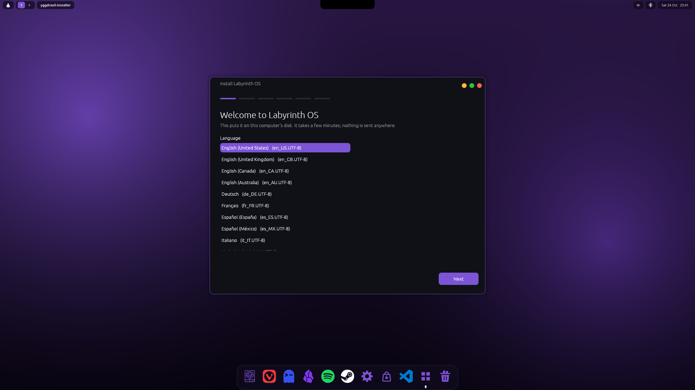
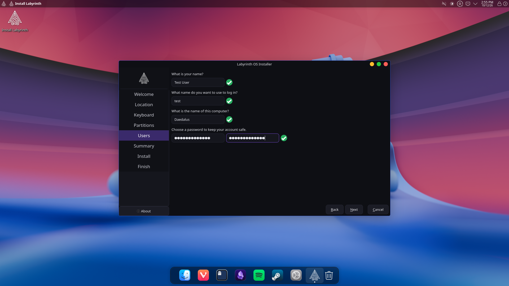
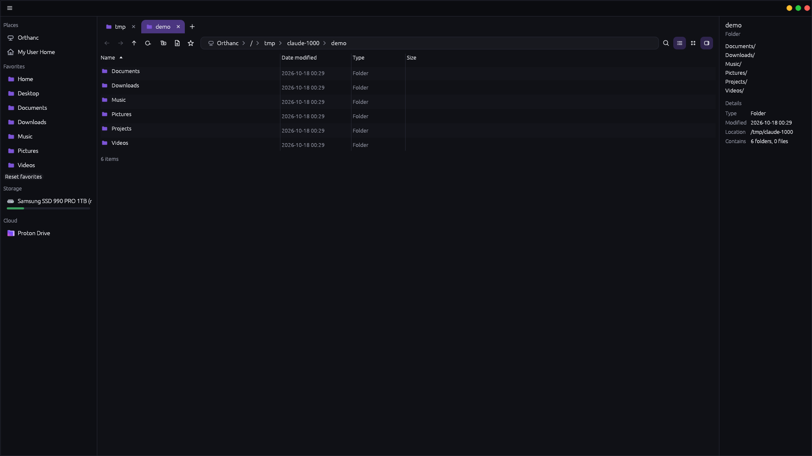
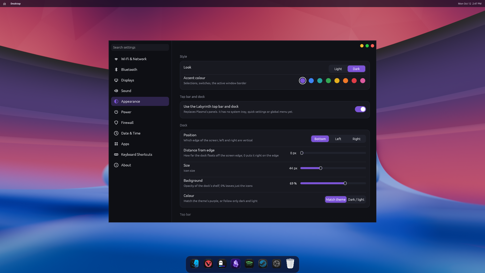
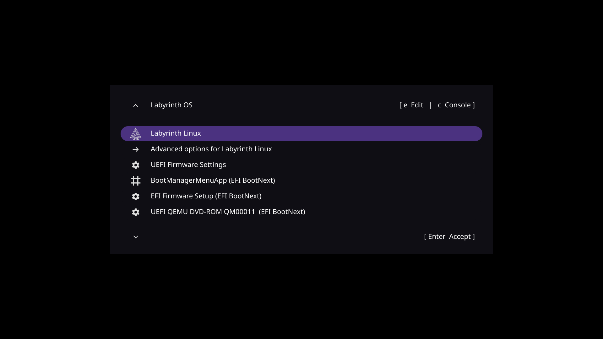

# Labyrinth OS

## Screenshots

| | |
| --- | --- |
|  |  |
| *The installer: the same dark look as the apps; the computer's name is asked here.* | *Name, login and computer name.* |
|  |  |
| *Minos: Storage lists the disk; select it for its partitions.* | *Settings > Appearance: dock position, distance from the edge, size, colour.* |

*The boot menu: Labyrinth's emblem, the UEFI firmware setting, and any other system found on the disks (Windows, another Linux). Theme: [grub-evodevo](https://github.com/ftonneau/grub-evodevo), MIT.*

A daily-driver Linux for one specific machine (for now), meant to replace Windows on it:

| Part | Hardware |
| --- | --- |
| CPU | Intel i9-9900K (Coffee Lake, AVX2, **no AVX-512**, so CachyOS `x86-64-v3`) |
| RAM | 64 GB |
| GPU | NVIDIA RTX 2080 Ti (Turing TU102, supported by the open kernel modules) |
| Disk | 1 TB |

Use cases: everyday desktop, music / photo / video work, CAD (Daedalus_CAD), gaming.

Labyrinth is a **distribution profile, not a kernel rewrite**. It does not
reimplement Linux; it assembles three upstreams plus the Artifex ecosystem:

| Upstream | Role in Labyrinth |
| --- | --- |
| [CachyOS](https://github.com/CachyOS/linux-cachyos) | Base: optimized `x86-64-v3` repos, `linux-cachyos` kernel (BORE/EEVDF, LTO), NVIDIA modules, gaming stack |
| [Omarchy](https://github.com/omacom/omarchy) | Desktop model: Hyprland, keyboard-first shortcuts, fast boot, AI integration |
| [EdenExplorer](https://github.com/mtucciarone/EdenExplorer) (MIT, Rust/egui) | Model for `minos`, the file explorer |
| Artifex ecosystem | Sarina, Limbo, Heimdall, Daedalus_CAD, Argus_App; shared with Chymaera_OS |

- [docs/ARCHITECTURE.md](docs/ARCHITECTURE.md): decisions and rationale
- [docs/DRIVER_LAB.md](docs/DRIVER_LAB.md): the Sarina + Limbo driver idea
- [docs/STATUS.md](docs/STATUS.md): what is built and what is not

## Status

Design and scaffold only. Nothing here has been built or booted: the dev
machine is Windows, and `mkarchiso` needs Arch/CachyOS and root.

## Documents

- [DESKTOP.md](docs/DESKTOP.md): the Hyprland desktop, bar, what came from Omacosy
- [COMPONENTS.md](docs/COMPONENTS.md): optional software (Spotify, Obsidian, Steam, Proton ...)
- [WEATHER.md](docs/WEATHER.md): the multi-model weather engine
- [INSTALLER.md](docs/INSTALLER.md): Calamares install, disk layout, Secure Boot
- [PROTON.md](docs/PROTON.md): Proton (games), Proton Drive, Proton Pass
