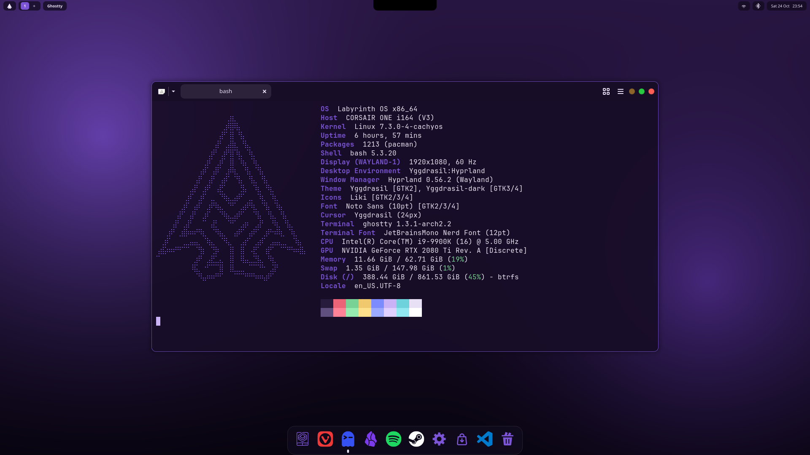
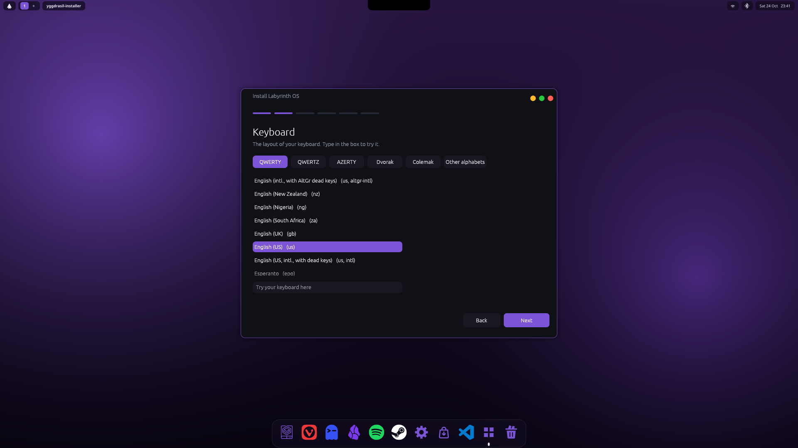
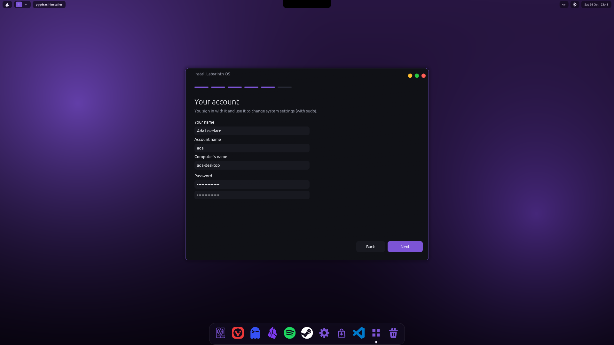
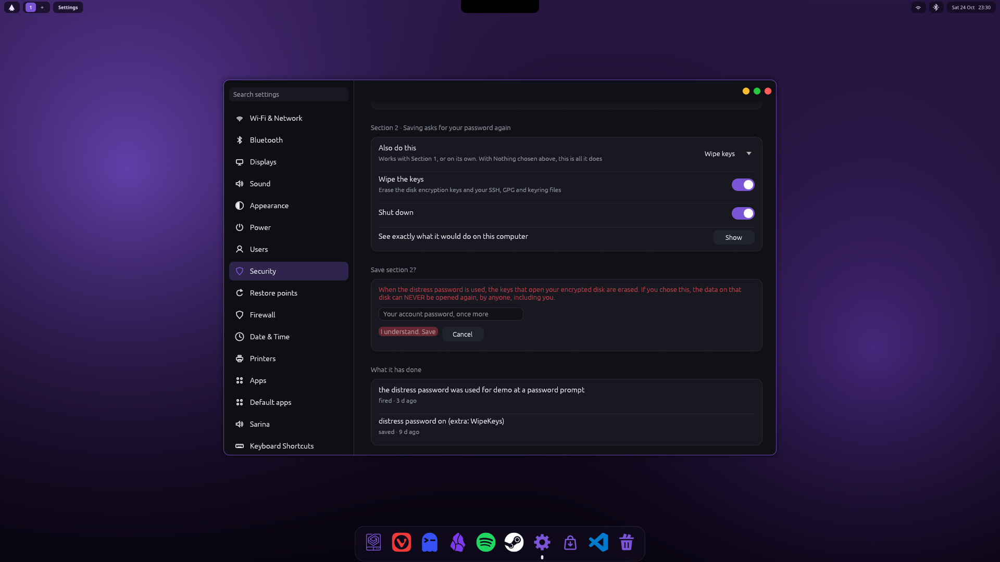

# Labyrinth OS

**Labyrinth OS** is a privacy- and security-first Linux distribution (CachyOS-based) with the Artifex ecosystem built in. Its desktop
is **Yggdrasil**, developed in its own repository and built to be reused: [Niflheim OS](https://github.com/ChymaeraLabs) (formerly
Chymaera OS) will use it too. The aim is the most secure Linux desktop that is still a normal, fun computer to use: games, music,
photo and video work, CAD, everyday browsing.

*The desktop: the top bar (start button, workspaces, the open app's name, network, Bluetooth, date and time), the dock, and
notification pop-ups at the bottom right. The black tab at the top middle is Fylgja, the notch.*

*`fastfetch` shows Labyrinth's emblem in Labyrinth's purple (`/etc/xdg/fastfetch/config.jsonc`; your own
`~/.config/fastfetch/config.jsonc` still wins). The local IP address is left out, since these get shared. The picture leaves out the
user and computer name line.*

## The desktop: Yggdrasil

Yggdrasil runs as its own session on Hyprland: top bar and dock, Fylgja, Settings, Agora (the app store), Minos (the file manager),
the lock and login screens (greetd), the password box, the screenshot tool, the video player and the installer. No KDE. Its README,
screenshots and docs are in [Yggdrasil](https://github.com/Artifex-Technologies/Yggdrasil). Labyrinth builds its packages from a
checkout next to this repository (`scripts/build-local-packages.sh`); what Labyrinth adds to the desktop (Heimdall, Sarina, the
installer's steps, the distress password) plugs in through integration files in `/usr/share/yggdrasil/integrations`.

## Installing

Labyrinth has its own installer: Yggdrasil's installer window with Labyrinth's install steps (`labyrinth-install-system`). It asks
for the language, the keyboard (by type: QWERTY, QWERTZ, AZERTY, Dvorak, Colemak), the time zone, the disk and the account. The disk
can be erased, or partitions chosen by hand, for example beside Windows, keeping its EFI partition. The system partition is
encrypted by default. See [Yggdrasil's docs/INSTALLER.md](https://github.com/Artifex-Technologies/Yggdrasil/blob/main/docs/INSTALLER.md).

| | |
| --- | --- |
|  |  |
| *Welcome: the language.* | *Keyboards by type; try one in the box.* |
|  |  |
| *Choosing partitions beside Windows: the free space becomes the system, the EFI partition is kept.* | *The account and the computer's name.* |

*(The installer pictures show sample disks and a sample name: `yggdrasil-installer --demo`.)*

*The boot menu: Labyrinth's emblem, the UEFI firmware setting, and any other system found on the disks (Windows, another Linux).
Theme: [grub-evodevo](https://github.com/ftonneau/grub-evodevo), MIT. (A picture from a virtual machine.)*

## Security and privacy

- **Heimdall** watches the computer from outside the programs it watches. It alerts on:
  - which program connects where (against offline threat lists), with the Wi-Fi guard and the DNS block list;
  - changed system files, and packages and kernels with known holes (it also checks the kernel's own CVE records, weekly);
  - settings that could be safer;
  - the AI assistant's behaviour.

  Suspicious files are moved to quarantine, ClamAV is consulted at once, and you decide what happens to them. Heimdall learns
  malware ClamAV does not know. If the AI assistant is ever compromised, Heimdall can contain it. See
  [Heimdall](https://github.com/Artifex-Technologies/Heimdall).
- **Hardened by default, at no cost you would notice**:
  - only the `kvm` group may run virtual machines, and the installer puts every user in it;
  - old serial-line modules are not loaded on request;
  - kernel addresses are hidden;
  - planted files and pipes in shared folders are refused;
  - BPF output is hardened.

  User namespaces stay on, since Steam, Flatpak and browsers need them, and so does nested virtualisation.
- **Limbo** runs untrusted things in disposable virtual machines.
- **Sarina**, the local AI assistant (optional, nothing leaves the computer), helps:
  - reviews Heimdall's findings every day and proposes fixes, which you approve and run;
  - analyses quarantined files for you.
- **Distress password**: a second password that quietly does something else when it is typed where your real one is asked for. The
  page opens only after you type your account password, and nothing is saved until you press Save. See
  [docs/DISTRESS_PASSWORD.md](docs/DISTRESS_PASSWORD.md).

| | |
| --- | --- |
|  |  |
| *Opening the page asks for your account password.* | *Turn it on, set the password, and how many times it must be typed within how long.* |
|  |  |
| *Section 1 (no extra password to save) and Section 2 (asks for your password again).* | *Saving Section 2 shows a warning and asks for your password once more.* |

*(These pictures show sample settings.)* More: [docs/SECURITY_ROADMAP.md](docs/SECURITY_ROADMAP.md).

## What it is built from

Labyrinth is a **distribution profile, not a kernel rewrite**. It assembles upstream projects and the Artifex ecosystem:

| Upstream | Role in Labyrinth |
| --- | --- |
| [CachyOS](https://github.com/CachyOS/linux-cachyos) | Base: optimized `x86-64-v3` repositories, the `linux-cachyos` kernel (and an LTS one as a fallback), NVIDIA modules, the gaming stack |
| [Hyprland](https://hyprland.org) | The compositor Yggdrasil's session runs on (until Yggdrasil's own compositor is ready) |
| [Omarchy](https://github.com/omacom/omarchy) | Ideas: keyboard-first shortcuts, fast start-up |
| [EdenExplorer](https://github.com/mtucciarone/EdenExplorer) (MIT, Rust/egui) | The model for Minos, the file manager |
| Artifex ecosystem | Yggdrasil, Heimdall, Limbo, Sarina, Daedalus_CAD, Argus_App; shared with Niflheim OS |

It is built and tested first on one machine (Intel i9-9900K, 64 GB, NVIDIA RTX 2080 Ti, 1 TB), where it replaces Windows.

## Status

Working: the ISO builds and boots, the installer completes (also beside Windows, encrypted), and the desktop runs on the author's
machine every day. Young: several parts are new, and it is built for one machine first. [docs/STATUS.md](docs/STATUS.md) says what
is built and what is not.

## Documents

- [ARCHITECTURE.md](docs/ARCHITECTURE.md): decisions and rationale
- [STATUS.md](docs/STATUS.md): what is built and what is not
- [COMPONENTS.md](docs/COMPONENTS.md): optional software (Spotify, Obsidian, Steam, Proton Drive/Pass ...)
- [DISTRESS_PASSWORD.md](docs/DISTRESS_PASSWORD.md), [SECURITY_ROADMAP.md](docs/SECURITY_ROADMAP.md): security
- [DRIVER_LAB.md](docs/DRIVER_LAB.md): the Sarina + Limbo driver idea
- [PROTON_GAMES.md](docs/PROTON_GAMES.md): Valve's Proton (Windows games in Steam); [PROTON_AG.md](docs/PROTON_AG.md): Proton AG's services
- Yggdrasil's [DESKTOP.md](https://github.com/Artifex-Technologies/Yggdrasil/blob/main/docs/DESKTOP.md),
  [INSTALLER.md](https://github.com/Artifex-Technologies/Yggdrasil/blob/main/docs/INSTALLER.md) and
  [WEATHER.md](https://github.com/Artifex-Technologies/Yggdrasil/blob/main/docs/WEATHER.md)

## License

Labyrinth OS's own files are under the [Mozilla Public License 2.0](LICENSE): use, change and share them, and changes to these
files stay open. The packages it installs (from Arch, CachyOS, the AUR and Flathub) keep their own licences; Yggdrasil, Heimdall,
Sarina and Limbo are MPL-2.0 too. See [THIRD_PARTY_NOTICES.md](THIRD_PARTY_NOTICES.md). The licence covers the files, not the names
and logos: "Labyrinth OS" and its emblem are not licensed for use by other projects.
